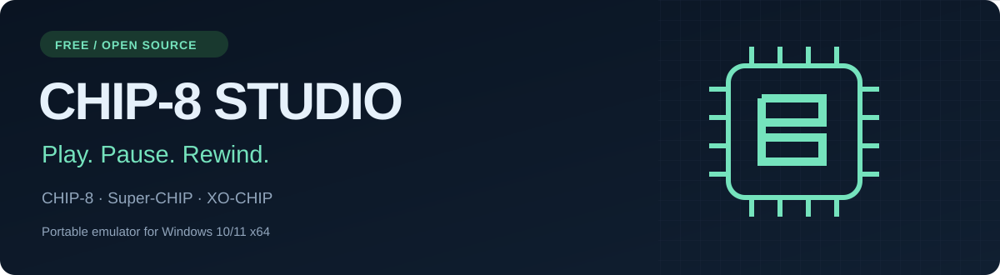
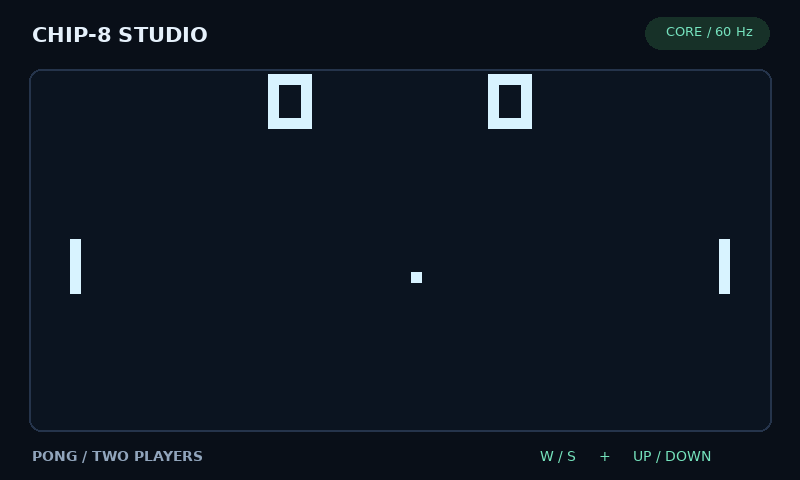
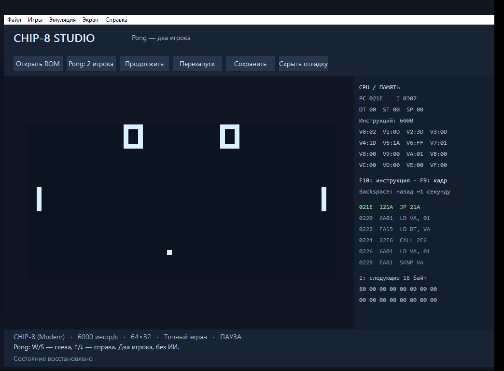

  
  
  

<a href="README.ru.md">Русский</a> · <a href="https://github.com/MyasAlex/CHIP8/releases/latest">Release notes</a> · <a href="docs/USER_GUIDE.md">Player guide</a> · <a href="docs/BUILDING.md">Build from source</a>

**A portable CHIP-8 emulator for Windows, with an offline game library, rewind and recording.** Download the ZIP, extract the entire archive and open **CHIP8.Emulator.exe**. Visual Studio and additional compiler DLLs are unnecessary for the release package. The current application interface is in Russian; this README and the player guide are available in English.

*Actual frames from the emulator core, with scripted paddle input. This preview shows the game display; the desktop application has its own window and menus.*

## Start playing

1. [Download CHIP8-Studio-Windows-x64.zip](https://github.com/MyasAlex/CHIP8/releases/latest/download/CHIP8-Studio-Windows-x64.zip).
2. Extract the whole ZIP to a folder and open **CHIP8.Emulator.exe**.
3. Pong for two players starts immediately. **W / S** move the left paddle; **↑ / ↓** move the right paddle.

Open your own ROM with **Ctrl+O** or drop it onto the window. The **Игры** menu also contains classic Pong against its ROM's opponent, Breakout and an animated demo. Windows 10/11 x64 is the target platform.

Open **Библиотека** or press **Ctrl+L** for the offline catalog. It includes **210 unique games, demos and programs**, original covers and notices, search, favorites, recent games and playtime. The original Studio Pong/demo bring the library to 212 unique entries. Eleven catalog programs require other platforms and are clearly marked. This is not every historical CHIP-8 ROM. Keep `roms/catalog` beside the EXE.

## What you get

| Feature | What it does |
| --- | --- |
| CHIP-8, Super-CHIP and XO-CHIP | Selectable compatibility profiles and individual instruction quirks. |
| XOR stabilization | Reduces sprite disappearance in classic Pong and Breakout. Switch to the exact display for tests or intentional flashing effects. |
| Save and rewind | Ten slots per ROM, autosave/resume, continuous rewind up to 120 seconds with a draggable timeline. Hold Backspace. |
| Pixel display | Integer scaling, fullscreen and PNG screenshots. |
| Debugging | Breakpoints, registers, memory, disassembly, trace, comparison PNG and reports. |
| Gamepads and sound | XInput support, classic beep and XO-CHIP audio patterns. |
| Offline use | Four built-ins in the EXE plus the bundled catalog. No account or connection required. |
| Screen effects | Exact, stable and phosphor modes, optional CRT effects and eight palettes. |
| Recording | GIF, H.264/AAC MP4 and deterministic input replays with per-frame checksums. |
| Game profiles | SHA-1 detection for 547 known ROMs, per-game settings and keyboard remapping. |
| Player tools | Turbo/slow motion, virtual keypad, settings transfer and explicit portable mode. |

See the actual Windows app and debug panel

Captured from the native Windows build during its smoke check.

## Controls

| Action | Key |
| --- | --- |
| Open ROM / pause / restart | Ctrl+O / P / F1 |
| Save / load / rewind | F5 / F8 / Backspace |
| Screenshot / fullscreen | F6 / F11; Esc leaves fullscreen |
| Step one frame / instruction | F9 / F10 |
| Debug panel / mute | F12 / M |
| Library / turbo / slow motion | Ctrl+L / hold Tab / hold Ctrl |

The physical keyboard rows **1234 / QWER / ASDF / ZXCV** map to CHIP-8 **123C / 456D / 789E / A0BF**. A Russian keyboard layout keeps the same physical controls. [Full guide and troubleshooting →](docs/USER_GUIDE.md)

## Version 3.0: a retro library and reproducible play

[Full 3.0 guide in Russian](docs/STUDIO_3_RU.md) · [Bilingual release notes](docs/releases/v3.0.0.md). MP4 uses Windows Media Foundation; if unavailable, GIF recording still works. Rewind storage is bounded to 64 MiB, so its available duration depends on the ROM's memory changes.

### Sprite stabilization retained from 2.1

Classic CHIP-8 programs often erase a sprite and draw it again in separate instructions. If a display frame falls between those operations, the object disappears for that frame. Studio observes the draw instructions and briefly holds an erased sprite until its matching redraw. It keeps this presentation separate from the guest display, collision flags and execution timing.

The exact display remains available. Stabilization is a visual heuristic, and can delay an object's disappearance by up to four frame boundaries (66.7 ms). [Implementation and regression results →](docs/FLICKER.md)

## Built to be checked

The repository includes **51 groups of core tests** and **31 offline Timendus ROM scenarios**, with framebuffer comparisons against C-Octo reference captures. All **199 launchable catalog profiles** are checked for a bounded five-second boot, not a full playthrough. GIF is decoded independently; the native Windows check covers the window, input, timeline, slots, replay, settings transfer and H.264/AAC recording before packaging.

Linux builds the portable core and test tools; the desktop frontend is Win32. The emulator does not implement Super-CHIP Legacy, CHIP-8X, MegaChip, or cycle-level COSMAC VIP / HP48 hardware emulation. Real speakers and physical gamepads still need testing on the user's machine.

## Help improve it

[Report a bug](https://github.com/MyasAlex/CHIP8/issues/new?template=bug_report.yml) with the ROM name, profile, CPU speed and steps to reproduce. [Suggest a feature](https://github.com/MyasAlex/CHIP8/issues/new?template=feature_request.yml) or read the [contribution guide](CONTRIBUTING.md).

If you enjoy it, a star or a link shared with another emulator enthusiast helps people find the project.

The emulator is MIT licensed. Guest ROMs and external test assets retain their own notices; see [THIRD_PARTY.md](THIRD_PARTY.md).
